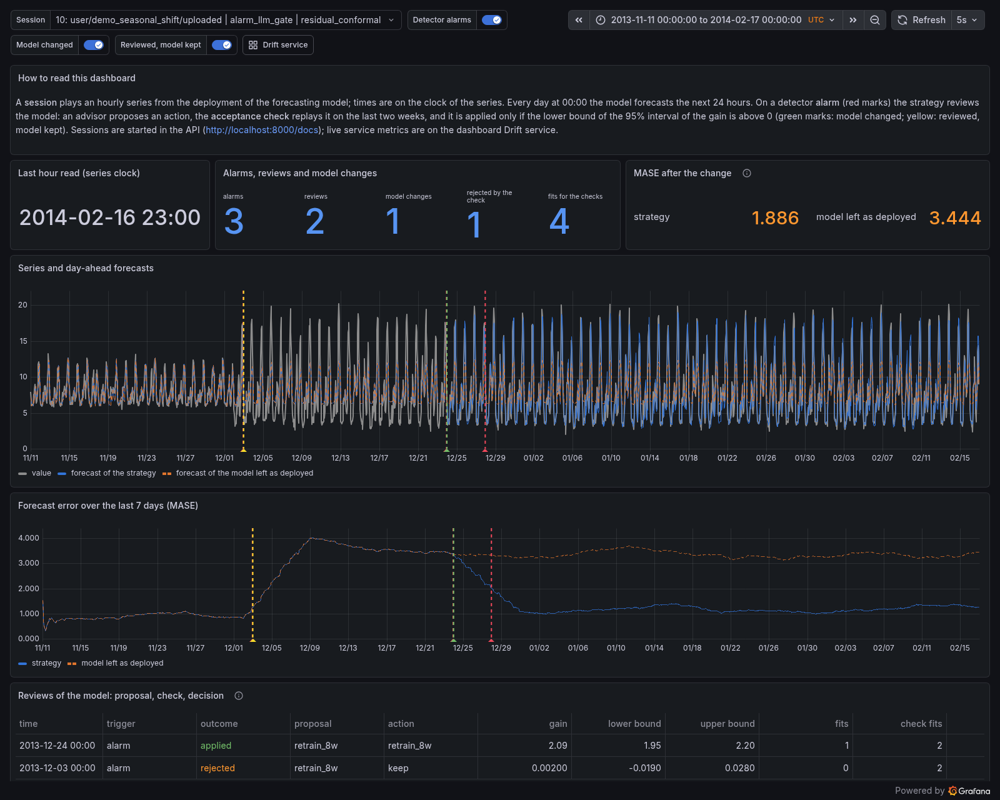
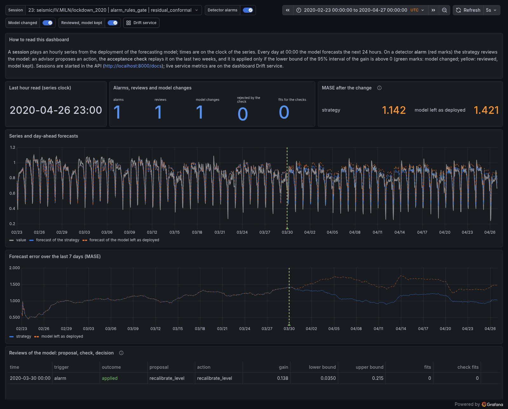

# Seasonality-Aware Drift Detection and Backtest-Verified Recommendations

Forecasting models of seasonal time series degrade when the data change, and two questions follow: has the series
really changed, or does it only follow its daily and weekly cycle, and what should be done with the model after an
alarm. This repository answers both in one system, built as a master's project of two students:

- **Stream A, detection** (Yelyzaveta Pereriadkina, `src/detector`): a seasonality-aware drift detector that watches
  the residuals of a causal STL decomposition with conformal thresholds, and a three-level benchmark that compares it
  with six classical detectors on series without changes, with injected changes and with annotated real changes.
- **Stream B, decisions** (Oleg Zadorozhnyi, `src/recommendations`, `src/api`): what to do after an alarm. An advisor
  (fixed rules or a language model) proposes one action from a catalog, a backtest on recent data applies the action
  only if its gain is confirmed, and the strategies are compared on 263 series; a monitoring service takes the same
  decisions on a stream of new data and shows them in Grafana.
- **Shared**: the data loaders and the standard frame (`src/data`), the link of the stream A detector to the decisions
  of stream B (`src/recommendations/alarms.py`) and a demo that takes one series through the whole system.

## Quick Start

```bash
git clone https://github.com/ElizPery/seasonality-drift-llm-backtest.git
cd seasonality-drift-llm-backtest
python3.12 -m venv .venv && source .venv/bin/activate
pip install -r requirements.txt
python -m pytest tests     # without any data: 69 pass, 2 skip (they need the exported series and the stored LLM answers)
```

Without any data download you can then run the demo on one series (below) and, from the stored results, the notebook
`stream_a_04_statistical_testing_detector` and the notebooks of stream B (two of them except one example that loads
raw data, see "Stored results").
`bash run_pipeline.sh` downloads the data of stream B, runs the tests and the backtest and starts the monitoring
service. "Reproducing the Results" at the end lists what each step needs.

## Architecture


Both streams read their data through `src/data`, which turns every source into the standard frame (`timestamp`,
`value`). Stream A builds a benchmark from these series, runs its residual conformal detector and six classical
detectors on it, scores all of them with one function and tests the differences; its result is one table with a row
per detector and benchmark series. Stream B keeps a day-ahead forecasting model for each of its 263 series and reviews
it on a weekly calendar or on the alarms of a detector: the detector of stream A, or ADWIN as the reference. At a
review an advisor proposes an action from the catalog, and in the checked strategies the acceptance rule replays it on
the last two weeks. The decision loop is the same code in both uses: the backtest replays it over the history of every
series and writes the results to CSV, and the monitoring service plays one series hour by hour, feeds the detector one
value at a time and shows the same decisions in Grafana. The language model advisor is reached through a gateway
(OpenRouter); every answer is stored, so a rerun reads the stored answers.

## Demo on One Series

`notebooks/demo_one_series.ipynb` takes one hourly series with a visible change through the whole system, one call at
a time: the deployed forecasting model and its error, the detector of stream A, the diagnostics and the prompt of the
advisor, the answer of the LLM, the backtest check, and the error with the system against the model left as deployed.
It needs no data download and no API key:

- the series is `data/demo/demo_seasonal_shift.csv`: a synthetic control series of the experiments whose weekly swing
  becomes 2.5 times larger on 2 December 2013 (`python -m src.recommendations.demo series` writes it again from the
  exported series);
- the answers of the LLM advisor on this series are stored in `data/demo/llm_answers` and are read instead of asking
  the model (with a key and another series the same code asks the model).

On this series the detector raises its first alarm 23 hours after the change. The backtest check stops the first
proposal of the advisor, because one day of new data cannot confirm a gain; the proposal after the next alarm, three
weeks later, passes it, and the error after the change is 1.89 against 3.44 for the model left as deployed (MASE),
45% lower. The strategy is `alarm_llm_gate`, one of the strategies of the experiments.

The same series in the monitoring service with Grafana:

```bash
docker compose up --build -d                   # API, PostgreSQL, Prometheus, Grafana; works without the exported series
python -m src.recommendations.demo session     # uploads the CSV, starts a session, prints the link to the dashboard
```

The last cell of the notebook does the same. The session uses the strategy `alarm_llm_gate`; the image of the service
has no LLM client, so it takes the stored answers (`data/demo/llm_answers` is mounted into the container) and gives
the numbers of the notebook. Any other hourly series can be uploaded in the same way (see "Your own series" below).



## Repository Structure

```text
    seasonality-drift-llm-backtest/
    │
    ├── data/
    │   ├── raw/                    # Raw data, not in git (see "Data Sources and Setup")
    │   ├── processed/              # Generated series and results; in git: the results of stream A
    │   │                           #   (multi_series_*) and of stream B (stream_b/)
    │   ├── alerts/                 # Alarms of the detectors on the stream B series and their calibrated settings
    │   ├── demo/                   # The series of the demo and the stored LLM answers on it
    │   └── llm_answers/            # Stored answers of the LLM advisors, unpacked from the archive (not in git)
    │
    ├── notebooks/
    │   ├── stream_a_01_eda_and_baselines.ipynb              # A: data, STL, single-series benchmark, baselines
    │   ├── stream_a_02_residual_conformal_evaluation.ipynb  # A: the detector on the single-series benchmark
    │   ├── stream_a_03_multi_series_residual_vs_baseline.ipynb # A: multi-series benchmark, all seven detectors
    │   ├── stream_a_04_statistical_testing_detector.ipynb   # A: Friedman and Nemenyi tests
    │   ├── stream_b_01_baselines.ipynb             # B: reference strategies, hindsight oracles, examples
    │   ├── stream_b_02_acceptance_rule.ipynb       # B: the acceptance rule and the advisors
    │   ├── stream_b_03_statistical_tests.ipynb     # B: rank tests of the strategies
    │   ├── common_link_alarms_to_backtest.ipynb    # A + B: detector alarms in the backtest
    │   └── demo_one_series.ipynb                   # A + B: the whole loop on one series, step by step
    │
    ├── src/
    │   ├── data/                   # Shared by both streams: loaders, the standard frame, the manifest
    │   │   ├── uci.py, entsoe.py, seismic_noise.py, alibaba.py, tcpd.py, iquique.py   # one loader per source
    │   │   ├── frames.py           # standard frame (timestamp, value), series_table, write_series
    │   │   ├── loader.py           # DataLoader class interface used by stream A
    │   │   └── export.py           # python -m src.data.export: the stream B series as CSV + manifest.csv
    │   │
    │   ├── detector/               # Stream A: detection and its evaluation
    │   │   ├── residual_detector.py    # ResidualConformalDriftDetector: causal STL residuals, conformal thresholds
    │   │   ├── baseline_detectors.py   # KS, PSI, Wasserstein (windows); ADWIN, Page-Hinkley, KSWIN (River)
    │   │   ├── drift_generator.py      # STL, seasonal strength, series without changes, injected changes
    │   │   ├── generate_benchmarks.py  # the three-level benchmark: one series per source or batches of series
    │   │   ├── run_baseline_evaluation.py          # the baselines on a benchmark manifest
    │   │   ├── run_residual_detector_evaluation.py # the detector on a benchmark manifest, settings per source
    │   │   ├── scoring.py              # one scoring function for all detectors
    │   │   ├── statistical_tests.py    # Friedman test and Nemenyi post-hoc test
    │   │   └── data_loader.py          # kept import path of DataLoader (the loaders live in src/data)
    │   │
    │   ├── recommendations/        # Stream B: forecasting model, decisions, backtest
    │   │   ├── forecast.py         # LightGBM day-ahead model, seasonal naive, MASE
    │   │   ├── catalog.py          # catalog of corrective actions
    │   │   ├── backtester.py       # strategies, hindsight oracles, acceptance rule, block bootstrap CI of the gain
    │   │   ├── synthetic.py        # synthetic series from UCI clients (MSTL control series + injected changes)
    │   │   ├── data_sources.py     # ENTSO-E and seismic noise series with features and labels
    │   │   ├── alarms.py           # detector alarms: stream A detector and ADWIN (batch and online), alerts file
    │   │   ├── llm_client.py       # diagnostics, prompts, answer schema, rule-based and LLM advisors
    │   │   ├── run_backtest.py     # stream B runner
    │   │   ├── stats_tests.py      # rank tests over the series (Friedman, Nemenyi, Wilcoxon with Holm)
    │   │   ├── strata.py           # groups of series by seasonal strength
    │   │   ├── llm_report.py       # LLM advisors on the real series: paired tests, action shares, figure
    │   │   ├── prompt_probe.py     # probe of the prompt wording
    │   │   ├── plots.py            # figures of the stream B notebooks
    │   │   ├── monitor.py          # Monitor: the decision loop as the data arrive (engine of the service)
    │   │   └── demo.py             # demo on one series: the series, figures, start of a session
    │   │
    │   ├── api/                    # Monitoring service (FastAPI)
    │   │   ├── main.py             # application: sessions, series, /detect, /recommendations, /metrics
    │   │   ├── sessions.py         # sessions playing a series in the background
    │   │   ├── uploads.py          # upload of your own series
    │   │   ├── store.py            # history of the sessions in PostgreSQL (for Grafana)
    │   │   └── schemas.py          # Pydantic schemas of requests and answers
    │   │
    │   └── monitoring/
    │       └── metrics.py          # Prometheus metrics (prometheus_client)
    │
    ├── tests/                      # Automated tests (pytest): data, alarms, backtester, LLM client, monitor, API,
    │                               #   demo, statistical tests
    ├── deploy/                     # Prometheus configuration, Grafana data sources and dashboards
    ├── docs/images/                # Figures of the README
    ├── docker-compose.yml          # API, PostgreSQL, Prometheus, Grafana
    ├── Dockerfile                  # image of the API
    ├── requirements.txt            # dependencies of the experiments, the service and the tests (Python 3.12)
    ├── requirements-service.txt    # dependencies of the service image
    ├── run_pipeline.sh             # data of stream B, tests, backtest and service in one command
    ├── LICENSE                     # MIT License
    └── README.md
```

## Data Sources and Setup

| # | Dataset | Used by | Location |
|---|---------|---------|----------|
| 1 | UCI ElectricityLoadDiagrams 2011-2014 | stream A (benchmark), stream B (synthetic series) | `data/raw/LD2011_2014.txt` |
| 2 | Alibaba Cluster Trace 2018 (Zenodo slice) | stream A | `data/raw/alibaba_cluster_trace.csv` |
| 3 | Turing Change Point Dataset (TCPD) | stream A (annotated real changes) | `data/raw/tcpd/` |
| 4 | SeisBench Iquique | stream A (single-series benchmark only) | downloaded by `seisbench` |
| 5 | ENTSO-E national load (Open Power System Data) | stream B | `data/raw/opsd/` |
| 6 | Seismic noise during the 2020 lockdowns | stream B | `data/raw/seismic_noise/` |

`bash run_pipeline.sh data` downloads datasets 1, 5 and 6.

### 1. UCI ElectricityLoadDiagrams 2011-2014 (`LD2011_2014.txt`)

A classic benchmark time-series dataset containing electricity consumption data for 370 clients sampled at 15-minute
intervals. Stream A uses five clients of 2013 (and the client MT_200 in the single-series benchmark); stream B builds
its synthetic series from the seasonal profiles of 20 clients.

* **Official Source:** [UCI Machine Learning Repository - ElectricityLoadDiagrams20112014](https://archive.ics.uci.edu/dataset/321/electricityloaddiagrams20112014)
* **Direct Download:** [UCI Zip Archive (249 MB)](https://archive.ics.uci.edu/static/public/321/electricityloaddiagrams20112014.zip)

#### Setup Instructions:
1. Download and extract `electricityloaddiagrams20112014.zip`.
2. Move the unzipped `LD2011_2014.txt` file into your local project directory:
   ```path
   data/raw/LD2011_2014.txt
   ```
3. The `load_uci_electricity()` method in `DataLoader` will automatically read and standardize this file.

### 2. Alibaba Cluster Trace 2018 (`alibaba_cluster_trace.csv`)

The raw Alibaba trace is large and resource-intensive to parse from scratch. For faster setup, use the pre-aggregated
and cleaned open-access slice provided on Zenodo.

* **Dataset Repository:** [DataCenter-Traces-Datasets on Zenodo](https://zenodo.org/records/14564935)
* **Target File:** `machine_usage_days_1_to_8_grouped_300_seconds.csv` (~200 KB)

#### Setup Instructions:
1. Navigate to the Zenodo dataset page linked above.
2. Download `machine_usage_days_1_to_8_grouped_300_seconds.csv`.
3. Save and rename the file into your local project directory:
   ```path
   data/raw/alibaba_cluster_trace.csv
   ```
4. The `load_alibaba_standard_trace()` and `load_alibaba_batch()` methods in `DataLoader` read this aggregated
   CPU, memory and network usage trace.

### 3. TCPDBench: Turing Change Point Dataset (TCPD, level 3 of the benchmark)

Real time series in which several annotators marked the change points independently (van den Burg and Williams,
2020). The annotated series serve as level 3 of the benchmark of stream A: JFK passengers, Iceland tourism and US
population, each scored against one annotator.

- **Dataset and annotations:** [GitHub - alan-turing-institute/TCPD](https://github.com/alan-turing-institute/TCPD)
- **Benchmark of change point methods:** [GitHub - alan-turing-institute/TCPDBench](https://github.com/alan-turing-institute/TCPDBench)

#### Setup Instructions:
1. Save each series as `data/raw/tcpd/<name>.csv` with a column `value` and optionally `timestamp`. The TCPD
   repository stores a series as `datasets/<name>/<name>.json`: the `raw` values of its first entry in `series` give
   `value`, and `time.raw` gives `timestamp`; without timestamps the loader builds a nominal calendar.
2. Save `annotations.json` of the TCPD repository (the change points of every annotator, by series) as
   `data/raw/tcpd/annotations.json`.
3. `load_tcpd_annotated_series()` and `load_tcpd_batch()` in `DataLoader` read a series and the change points of the
   chosen annotator.

### 4. SeisBench Iquique Seismic Trace Dataset

SeisBench provides standardized seismic datasets for machine learning applications in seismology. A waveform of the
Iquique dataset with a picked P-wave arrival as the change point was used in the exploratory runs and in the
single-series benchmark of stream A; a waveform has no seasonal period, so the residual detector is not run on it.

- **Official Source / Toolkit:** [GitHub - SeisBench/seisbench](https://github.com/seisbench/seisbench)

#### Setup Instructions:
1. `seisbench` is installed with `requirements.txt`; `load_seismic_dataset()` in `DataLoader` downloads the dataset on
   first use and picks a waveform with valid arrivals.

### 5. ENTSO-E National Load (Open Power System Data), Stream B

Hourly national electricity load of 32 European countries, 2015 to September 2020, from the ENTSO-E Transparency
Platform as packaged by Open Power System Data. Stream B uses 8 countries (IT, PL, ES, NL, PT, FR, DE, GB) and the
date of the first national COVID-19 measures in March 2020 as the moment of change.

- **Official Source:** [Open Power System Data - Time series](https://data.open-power-system-data.org/time_series/2020-10-06)
- **Target File:** `time_series_60min_singleindex.csv` (124 MB)

#### Setup Instructions:
```bash
mkdir -p data/raw/opsd
curl -L -o data/raw/opsd/time_series_60min_singleindex.csv \
  https://data.open-power-system-data.org/time_series/2020-10-06/time_series_60min_singleindex.csv
```

### 6. Seismic Noise During the 2020 Lockdowns (Lecocq et al., 2020), Stream B

Displacement RMS every 15 minutes at seismic stations, November 2019 to May 2020, from the companion repository of
Lecocq et al. (2020), Science 369(6509):1338-1343. The 4-14 Hz band is dominated by human activity (traffic, industry),
so it has clear daily and weekly cycles. Stream B uses 15 stations; the moment of change is the date of the first
measures at each station from the paper's Table S1. This is a different dataset from the SeisBench Iquique records above.

- **Official Source:** [GitHub - ThomasLecocq/2020_Science_GlobalQuieting](https://github.com/ThomasLecocq/2020_Science_GlobalQuieting)

#### Setup Instructions:
```bash
R=https://raw.githubusercontent.com/ThomasLecocq/2020_Science_GlobalQuieting/master
mkdir -p data/raw/seismic_noise
curl -L -o data/raw/seismic_noise/lockdown_stations.csv "$R/Supplementary%20Files/Table%20S1%20-%20Lockdown%20stations.csv"
for f in BE.UCC..HHZ IV.MILN..HHZ IV.FIR..HHZ FR.CURIE.00.HHZ GB.EDI..HHZ NL.ALK1..HGZ GE.STU..HHZ GR.BUG..HHZ \
         CA.ICJA..HHZ CH.SZUZ..HGZ OE.VIE..HHZ LD.CPNY..BHZ AM.R091F.00.EHZ AM.R9F13.00.EHZ AM.S0C34.00.EHZ; do
  curl -L -o "data/raw/seismic_noise/$f.csv" "$R/PaperZero_RMS/$f.csv"
done
```

## Shared Data Loading (`src/data`)

Both streams read their data through `src/data`. Every loader returns the same standard frame: a DataFrame
with the columns `timestamp` (start of the interval) and `value` (float64), one row per point in time order.
`DataLoader` (`src/data/loader.py`, also importable from `src/detector/data_loader.py`) keeps the class
interface of the stream A scripts and notebooks; `load_uci_electricity` now reads the cleaned hourly client
table of `src/data/uci.py` (timestamps moved to the interval start, DST hours fixed, cached in
`data/processed/uci_hourly.parquet`).

The series of stream B (synthetic UCI, ENTSO-E, seismic noise) can be written as standard frames for the
detectors of stream A:

```bash
python -m src.data.export            # data/processed/series/: one CSV per series + manifest.csv
```

`manifest.csv` has one row per series: `id` (`source/series/scenario`), `file`, the labels (`source`,
`series`, `scenario`, `client`, `seed`, `magnitude`), the length `n`, `start`, and the deployment and
change points both as positions (`t_deploy`, `t_change`, `t_stop`) and as timestamps (`deploy_at`,
`change_at`). Detector alarms on these series are matched to the backtest by `id` and `timestamp`.

## Stream A: Seasonality-Aware Drift Detection (`src/detector`)

Classical drift detectors applied to the raw values of a seasonal series take the daily or weekly cycle for a change
and raise many false alarms. Stream A removes the seasonal profile first and watches what is left.

#### The residual conformal detector (`residual_detector.py`)

`ResidualConformalDriftDetector` works in three steps:

1. **Causal decomposition.** The first max(2p, w) points (p the seasonal period, w the calibration window) are
   decomposed at once with the robust STL of statsmodels. After that the series is processed in blocks of p points,
   and each block is decomposed on a history of at most max(6p, 3w) points that ends with the block, so a change after
   a block cannot affect its residuals.
2. **Conformal threshold.** At every point the previous w residuals form the calibration window. With m their median
   and q the conformal quantile of their absolute deviations from m at level 1 - alpha (the ceil((1 - alpha)(w + 1))-th
   smallest deviation), the threshold of a single point is T = c * q, where c is the sensitivity multiplier.
3. **Three scores.** A point violates the rule if the current residual deviates from m by more than T (abrupt
   changes), if the mean of the last v residuals deviates from m by more than 1.35 * T / sqrt(v) (gradual changes), or
   if the interquartile range of the last v residuals is more than 1.8 * c times that of the calibration window
   (changes of the seasonal amplitude or of the noise). An alarm is raised after `min_consecutive_alerts` violations
   in a row and is followed by a pause of `cooldown_steps` points.

Settings of the comparison (`RESIDUAL_DETECTOR_CONFIGS["single"]` in `run_residual_detector_evaluation.py`, used by
the notebooks): alpha = 0.05, w = 150, v = 16, c = 1.6 (1.3 for the Alibaba series), 2 consecutive violations (1 for
Alibaba) and a pause of 40 points. The `"multi"` settings scale the windows to the period and the length of a series;
stream B uses them with a daily period (see "How the Two Streams Connect").

#### Baseline detectors (`baseline_detectors.py`)

`BaselineDetectorWrapper` runs six classical detectors on the raw values with the settings of
`run_baseline_evaluation.py`: the Kolmogorov-Smirnov test (p < 0.01), the population stability index (above 0.1) and
the Wasserstein distance (above 0.5), each comparing a reference window and a current window of 100 points every 25
points, and ADWIN (delta = 0.002), the Page-Hinkley test (threshold 50) and KSWIN (alpha = 0.01, window of 100 points,
fixed seed) from River, updated with every point.

#### The three-level benchmark (`drift_generator.py`, `generate_benchmarks.py`)

- **Level 1, series without changes** (false alarm rate): the STL trend of a series is replaced by its median, the
  seasonal component is kept, and the remainder is resampled with a block bootstrap in blocks of one period, with a
  fixed random seed.
- **Level 2, injected changes** (detection of a change of known type, moment and size): at the middle of a series an
  abrupt change (a constant of k sigma), a gradual change (a linear ramp that reaches k sigma at the end of the series)
  or a change of the seasonal amplitude (the seasonal component times k is added) is injected, with k = 0.5, 1, 2 and
  3 and sigma the standard deviation of the STL remainder.
- **Level 3, annotated real changes**: series of TCPD with change points marked by human annotators.

Every series also gets its seasonal strength F = max(0, 1 - Var(R) / (Var(S) + Var(R))) and a group: weak below 0.30,
moderate below 0.65, strong from 0.65. There are two benchmarks:

- one series per source (`generate_all_benchmarks`, run by `python -m src.detector.generate_benchmarks`): the CPU
  utilisation of the Alibaba cluster, the UCI client MT_200, the JFK passengers of TCPD and a SeisBench Iquique
  waveform; manifest `data/processed/benchmark_manifest.json` (notebooks `stream_a_01` and `stream_a_02`);
- the multi-series benchmark of the comparison (`generate_multi_series_benchmarks`, notebook `stream_a_03`): two
  Alibaba series, five UCI clients of 2013 and three TCPD series (JFK passengers, Iceland tourism, US population). They
  give 10 series without changes, 84 series with injected changes (7 series x 3 types x 4 magnitudes) and 3 annotated
  series; manifest `data/processed/multi_series_benchmark_manifest.json`.

#### Scoring and statistical tests (`scoring.py`, `statistical_tests.py`)

All detectors are scored by one function, `score_alerts_for_series`. On level 1 every alarm is false, and the false
alarm rate is the number of alarms per 1000 points. On levels 2 and 3 an alarm within 50 points after a change point
that is not matched yet is a true positive, each change point is matched once, every other alarm is a false positive
and an unmatched change point is a false negative; precision, recall and the F1 score follow, and the delay is
measured to the matched alarm. `evaluate_detectors_statistically` runs the Friedman test on the ranks of the
detectors and, if it rejects equal performance at the 5% level, the Nemenyi post-hoc test (scikit-posthocs). The
blocks are the 10 series for the false alarm rate, the 24 combinations of source, change type and magnitude for the F1
score and the delay on level 2 (for the delay only those in which every detector found the change) and the 3 series of
level 3.

#### Notebooks and stored results

- `stream_a_01_eda_and_baselines`: the data, the STL decomposition, the single-series benchmark and the baselines;
- `stream_a_02_residual_conformal_evaluation`: the detector on the single-series benchmark, compared with the baselines;
- `stream_a_03_multi_series_residual_vs_baseline`: the multi-series benchmark, all seven detectors, the results by
  level and by seasonal strength;
- `stream_a_04_statistical_testing_detector`: the Friedman and Nemenyi tests.

The results of the comparison are kept in git: `data/processed/multi_series_detector_comparison_results.csv`, one row
per detector and benchmark series (source, series, seasonal strength and group, level, change type, magnitude,
detector, false alarms, false alarm rate, precision, recall, F1 score, delay, detected), and the manifest of the
multi-series benchmark.
`stream_a_04` runs from this file on a clean clone; the other three notebooks need the benchmark, which is built from
the raw data (datasets 1 to 4).

#### Run:
```bash
python -m src.detector.generate_benchmarks      # single-series benchmark: data/processed/benchmark_manifest.json + series
python -m src.detector.run_baseline_evaluation  # the baselines on it: data/processed/baseline_evaluation_results.csv
# then the notebooks: stream_a_02 (the detector on this benchmark), stream_a_03 (the multi-series benchmark and all
# detectors, writes multi_series_detector_comparison_results.csv) and stream_a_04 (the tests on that file)
```

## How the Two Streams Connect

- **Data.** Both streams use the loaders and the standard frame of `src/data`. `python -m src.data.export` writes the
  263 series of stream B as standard frames with a manifest, so the detector of stream A runs on them unchanged.
- **Alarms.** `src/recommendations/alarms.py` wraps `ResidualConformalDriftDetector` with the `"multi"` settings for a
  daily period. In the backtest it runs on the whole series, and every alarm is dated at the end of its STL block, the
  first hour at which it is known; in the monitoring service `ResidualStream` feeds it one value at a time and gives
  the same alarms. ADWIN runs next to it as the reference detector. Both are calibrated per source to one false alarm
  per 14 days on a control period without changes, and their alarms are stored in `data/alerts/alerts.csv` with the
  settings in `data/alerts/detectors.csv` (details in the section on stream B below).
- **Decisions on alarms.** The strategies `alarm_*` of stream B review the forecasting model at the first origin after
  an alarm instead of on a weekly calendar. `notebooks/common_link_alarms_to_backtest.ipynb` compares the two
  detectors as triggers, and `notebooks/demo_one_series.ipynb` shows the whole chain on one series.

## Main Results

Stream A (`multi_series_detector_comparison_results.csv`, notebooks `stream_a_03` and `stream_a_04`):

- On the series without changes the detector raises 6.01 false alarms per 1000 points, 78% to 80% fewer than the
  population stability index, the Wasserstein distance and the Page-Hinkley test (28 to 30), but more than ADWIN (1.04)
  and KSWIN (3.80).
- On the 84 injected changes it has the best F1 score (average rank 1.35 of 7) and is significantly better than five of
  the six classical detectors (Nemenyi test, p < 0.05; against KSWIN p = 0.074); it finds 64% of the changes and 86%
  of the changes of the seasonal amplitude.
- On the 3 annotated real series its F1 score is 0.69 against at most 0.25 for the classical detectors; with three
  series the Friedman test finds no significant difference (p = 0.18).

Stream B (`data/processed/stream_b/runs.csv`, notebooks `stream_b_01` to `stream_b_03`, `llm_report.py`):

- The acceptance rule removes 82% of the retrainings of a weekly schedule (624 instead of 3477 on the 263 series), at a
  MASE after the change of 0.72 against 0.70 on the national load, and stops harmful advice: the rule-based advisor is
  worse than doing nothing on 11% of the series with the check and on 42% without it.
- None of the 42 tested configurations of the language model advisor (7 models of 5 vendors, the four prompt variants
  with diagnostics, weekly and on alarm) differs significantly from leaving the model unchanged on the 23 real series (smallest p = 0.063), while
  weekly retraining, the checked schedule and the checked catalog are significantly better than it (paired Wilcoxon
  tests with the Holm correction).
- On the demo series the system lowers the error after the change by 45% (MASE 1.89 against 3.44).

## Stream B: Adaptation Strategies and Backtest (`src/recommendations`)

A deployed LightGBM model forecasts every day the next 24 hours (all features use values at least 24 hours old:
hour, weekday, lags 24/48/168/336, lagged daily and weekly means; yearly terms for the national load). A strategy
decides when the model is changed and how:

- `nothing`: the model trained at deployment is never changed;
- `always`: retrain on all history every day;
- `scheduled`: retrain on all history once a week;
- `scheduled_gate`: once a week, retrain on all history only if the acceptance rule confirms the gain;
- `catalog_gate`: once a week, check every catalog action with the acceptance rule and apply the one with the highest
  lower bound of the gain (or keep the model if none passes);
- `oracle_weekly`: once a week, apply the catalog action with the lowest error on the following week, chosen in
  hindsight (the reference for LLM recommendations);
- `oracle`: the same every day with a one-day lookahead (the ideal ceiling).

The oracles use future data, so they cannot be deployed; they only bound what any policy can reach. Action catalog
(`catalog.py`): do nothing, retrain on all history, retrain on the last 8 weeks, shorten the window to 2 weeks,
reweight recent data (half-life 1 week), add a seasonal feature (4-week hour-of-week profile), recalibrate the forecast
level on the last week.

Metrics: MASE (scaled by the weekly seasonal naive error on the training data) before and after the change, regret
against the ideal oracle, number of retrainings, and the gain over `nothing` with a 95% moving block bootstrap
interval over days (blocks of 7 days, 2000 resamples).

Acceptance rule (`check_action` in `backtester.py`): at a decision point the recommended action is replayed on the
last 2 weeks with a weekly rolling origin (its recipe is applied to the data before each origin and forecasts the
following week) and compared with what the deployed model actually forecast there. The action is applied only if the
lower bound of the 95% block bootstrap interval of the gain (blocks of 3 days) is above delta = 0. Only data before
the decision point is used.

LLM recommendations (`llm_client.py`): at a decision point the advisor gets diagnostics computed from the data before
it (weekly errors of the deployed model, bias, level, daily amplitude and noise changes, weeks since the last change)
and answers with one catalog action and a short reason (Pydantic schema, validated by Instructor in JSON mode).
Strategies `llm` (applied as proposed) and `llm_gate` (applied only if the acceptance rule confirms it); `rules` and
`rules_gate` use fixed rules on the same diagnostics. Five prompt variants (`--prompt`): `base` (the system prompt
with the catalog and the diagnostics), `instructions` (plus how to read the diagnostics and when each action fits),
`examples` (plus four worked decisions from a synthetic series that is not evaluated), `bare` (ablation: no
diagnostics) and `rich` (the diagnostics of `base` plus the error and bias of each of the last 14 days, the last 48
hours of values against the forecast, and the previous decision with the error before and after it). Every LLM
answer is stored locally in `data/llm_answers/`. The answers of the reported runs (about 43,000) and of the prompt
probe are published as a separate archive, [llm_answers.zip](https://drive.google.com/file/d/16I7OORFDomTBxDHQkju91yIA2cb15p2d/view?usp=sharing)
(5.5 MB, SHA-256 `9ffc772aaba6cad61f8ec214440526b40addf94e0dc0fd4bd40f0fb7c8528c5b`), to keep the repository small:
`unzip llm_answers.zip` in the root of the repository creates `data/llm_answers` and `data/llm_probe`, and a rerun
then reads the stored answers and needs no API key. The model string names the provider first (`openrouter/...`,
`anthropic/...`, `ollama/...`); the key is read from `~/.config/diploma/<provider>.env`, one line
`<PROVIDER>_API_KEY=...` (another folder can be set in `LLM_KEY_DIR`).

Decisions on detector alarms (`alarms.py`, the link with stream A): the strategies `alarm_retrain`, `alarm_gate`,
`alarm_catalog_gate`, `alarm_oracle`, `alarm_rules`, `alarm_rules_gate`, `alarm_llm` and `alarm_llm_gate` take the
same decisions as their weekly counterparts, but at the first origin after an alarm of a drift detector, then ignore
alarms for 7 days (`cooldown_days`). They run once per detector in an alerts file: one row per alarm with `id`
(`source/series/scenario` as in the manifest of `src/data`), `method` and `timestamp` (or `index`); detector
alarms are matched to the series by `id` and `timestamp`. Every row of `runs.csv` also reports `alarms` (alarms after
deployment), `acts_pre` (model changes before the change of the series, all of them on a series without one: the cost
of false alarms or of a fixed calendar) and `reaction_h` (hours from the change to the first model change after it).
The detector of stream A runs on these series as `residual_conformal`: `ResidualConformalDriftDetector` of
`src/detector` with the settings of its multi-series mode for a daily period. Its residual of an hour comes from an STL
fit on a block that ends up to 23 hours later, so an alarm is dated at the end of its block, the first hour at which it
is known (the tests check that the alarms are those of its `fit_predict` and do not depend on later values). ADWIN
(`adwin`) runs next to it as the reference detector, on the residual of each hour from the median of the same hour of
the last 4 weeks, which uses only the past. A conformal stand-in on the same residuals (`profile_conformal`) served
until the stream A detector was connected and has been removed. The sensitivity of every detector
is calibrated per source on a control period without changes (the 60 synthetic control series; the seismic weeks
between deployment and the first measures; the year 2019 of the national load) to one false alarm per 14 days (2.98 per
1000 hours): settings calibrated on one source do not carry over to another. `data/alerts/detectors.csv` records the
chosen settings and the false alarm rate reached: `residual_conformal` gets the multiplier 8 on the national load (1.99
per 1000 hours) and on the seismic noise (3.04, the strictest value of its grid, just above the target) and 4 on the
synthetic series (2.90); ADWIN does not reach the target on the national load even at its strictest setting (8.30).
`data/alerts/alerts.csv` holds the alarms of both detectors (kept in git).

Data: 240 synthetic series (20 UCI clients x 3 seeds x {no change, level shift 2 sigma, one-week ramp 2 sigma,
noise x2}, 24 weeks, deployment at week 10, change at week 13), the national load of 8 countries (dataset 5,
deployment 6 January 2020) and the seismic noise level at 15 stations (dataset 6, hourly log10 on the local clock,
deployment 3 February 2020).

#### Run:
```bash
export OMP_NUM_THREADS=1                                     # every process trains its own models
python -m src.recommendations.run_backtest --tune            # base model validation (not the test period)
python -m src.recommendations.run_backtest                   # all sources, about 40 minutes on 16 cores
python -m src.recommendations.run_backtest --sources seismic # recompute one source, keep the other rows
python -m src.recommendations.run_backtest --advisors rules  # add the advised strategies (rules, llm) to runs.csv
python -m src.recommendations.run_backtest --advisors llm --llm-model ollama/qwen2.5:7b-instruct --prompt examples --repeats 3
                                                             # LLM strategies with one model and one prompt variant
python -m src.recommendations.alarms                         # calibrate the detectors, write data/alerts/alerts.csv
python -m src.recommendations.run_backtest --alerts data/alerts/alerts.csv --advisors rules
                                                             # add the strategies that review on alarms, per detector
python -m src.recommendations.llm_report                     # LLM advisors on the real series: paired tests against the
                                                             # reference strategies, shares of the chosen actions and the
                                                             # figure of error against retrainings (docs/images)
python -m src.recommendations.prompt_probe                   # probe of the prompt wording: the same diagnostics with a system
                                                             # message that states the goal and the costs (data/llm_probe)
python -m pytest tests                                       # tests
```

Results are written to `data/processed/stream_b/` (`runs.csv`, `summary.csv`, `oracle_picks.csv`, `tune.csv`,
`example_*.csv`); tables and figures are in the notebooks `stream_b_01` to `stream_b_03` and
`common_link_alarms_to_backtest`. The published results were computed with Python 3.12, numpy 2.2.6, pandas 2.3.3,
statsmodels 0.15.0 and lightgbm 4.7.0.

#### Stored results

The results of the reported runs are kept in git in `data/processed/stream_b/`: `runs.csv` (one row per series,
strategy and repeat), `summary.csv`, `strata.csv`, `oracle_picks.csv`, `tune.csv`, `recalibrate_weekly.csv` (the
weekly level recalibration on the 263 series, an input of `llm_report.py` that needs the raw data to recompute) and
the three series of the examples (`example_*.csv`). On a clean clone without the raw data, `llm_report.py` and the
notebooks `stream_b_01_baselines` and `stream_b_03_statistical_tests` run in full; `stream_b_02_acceptance_rule`
and `common_link_alarms_to_backtest` run except their example on the seismic series of Milan, which loads the raw
data (dataset 6 above). The tables of `llm_report.py` (`llm_paired_tests.csv`, `llm_synthetic_tests.csv`,
`llm_action_shares.csv`) are not stored: the command writes them in a few seconds, the shares of the actions from
the unpacked answers.

#### Statistical comparison of the strategies

`src/recommendations/stats_tests.py` compares the strategies over the series with the rank tests recommended by
Demsar (2006): per series the strategies are ranked by MASE after the change (on the control series by MASE after
deployment), the Friedman test and its Iman-Davenport form check whether the average ranks differ, the Nemenyi critical
difference shows which differences of average rank are significant, and paired Wilcoxon signed-rank tests with the
Holm correction check the comparisons behind the claims (the checked schedule against the plain one, the rules with
and without the check and against doing nothing, retraining on alarm against the calendar, the best checked action
against the weekly oracle). The groups are the national load, the seismic noise, both together, and each synthetic
scenario; the ranking contains the 17 deployable strategies, the oracles and the seasonal naive forecast are
references. `notebooks/stream_b_03_statistical_tests.ipynb` reads `runs.csv` and shows the tables and the critical
difference diagrams.

## Monitoring Service (`src/api`, `src/monitoring`, Docker)

The service runs the decision loop of stream B on a deployed model as the data arrive. A **session** plays one
exported series hour by hour from the deployment of the model: every day at 00:00 the model forecasts the next 24
hours, each new value is compared with its forecast and fed to a drift detector, and on an alarm (or on the calendar,
for the weekly strategies) the strategy reviews the model: the advisor proposes a catalog action, the acceptance rule
replays it on the last two weeks, and the action is applied only if the lower bound of the 95% interval of the gain is
above 0. A second run of `nothing` on the same series shows the error the model would have without any change.

The decisions are taken by the code of the backtest (`StrategyRun` in `backtester.py`, the loop that `backtest` also
drives), and the detectors run one value at a time (`OnlineDetector` in `alarms.py`) with the alarms of the
batch functions. A series played to its end therefore gives the numbers of `runs.csv`: for example, the national load
of Portugal under `alarm_rules_gate` with `residual_conformal` ends with 4 alarms, 4 reviews, no model change and MASE
after the change 0.7548643518593062, the value in `runs.csv`. `tests/test_monitor.py` and `tests/test_api.py` check
this on a small series.

- `src/recommendations/monitor.py`: `Monitor`, the engine of a session (no web code).
- `src/api/main.py`: FastAPI application; `sessions.py` (sessions playing in the background), `uploads.py` (series
  added through the API), `store.py` (history in PostgreSQL for Grafana), `schemas.py` (requests and answers).
- `src/monitoring/metrics.py`: Prometheus metrics, served at `/metrics/`.
- `docker-compose.yml`, `Dockerfile`, `requirements-service.txt`: the API, PostgreSQL, Prometheus and Grafana;
  `deploy/` holds the Prometheus configuration and the provisioned Grafana data sources and dashboards.

#### Run:
```bash
python -m src.data.export                 # once: the series the service plays, in data/processed/series
docker compose up --build -d              # API http://localhost:8000/docs, Grafana http://localhost:3000, Prometheus :9090
curl -X POST localhost:8000/sessions -H 'content-type: application/json' \
     -d '{"series_id": "seismic/IV.MILN/lockdown_2020", "strategy": "alarm_rules_gate", "detector": "residual_conformal", "speed": 12}'
                                          # the answer has `grafana_url`: the dashboard of this session around the change
curl -X POST 'localhost:8000/series/csv?name=shop_42&deploy_at=2024-03-04' -H 'content-type: text/csv' \
     --data-binary @my_series.csv         # your own data: see "Your own series" below
docker compose down                       # stop (add -v to delete the history and the uploaded series)
uvicorn src.api.main:app --port 8000      # or without Docker: no history for Grafana, the API and the metrics stay
```

#### Your own series

The loop also runs on data that are not part of the experiments. A series is uploaded as a standard frame, a CSV with
the columns `timestamp` and `value` and one row per hour without gaps (`POST /series/csv`, the file is the body of the
request), or as JSON with `start` and `values` (`POST /series`). `deploy_at` is the moment the forecasting model goes
to work: the values before it are its history (at least 8 weeks), the values from it on are played by a session (at
least 3 weeks); `change_at` is optional and only adds the error after a known change to the answers. The series gets
the id `user/<name>/uploaded` and is then used like an exported one in `POST /sessions` and `POST /detect`; it is kept
in `data/processed/uploads` (a Docker volume) and can be deleted with `DELETE /series/{id}`.

The detector settings of the experiments are calibrated per source, so an uploaded series gets its own: each detector
is calibrated on the history of the series, on the hours from week 5 to the deployment, to the same target of one false
alarm per 14 days, and the answer of the upload shows the settings and the rate reached. Only values before the
deployment are used. One series gives a short control period (3 weeks at the minimum history), so these settings are
rougher than those of the experiments and tend to be more sensitive; `detector_value` of a session overrides them.
For example, the Milan series uploaded as a CSV gets the multiplier 5 for `residual_conformal` from its own 8 control
weeks (8 in the experiments, from 15 stations) and ends with 3 alarms, 2 model changes and MASE after the change
1.120; with `detector_value` 8 it gives the session of the exported series, 1 alarm and 1.142. The features use the
hour and the weekday of the timestamps as they are given, so the stamps should follow the clock of the daily cycle.

Endpoints: `GET /series`, `POST /series`, `POST /series/csv`, `DELETE /series/{id}` (uploaded series),
`GET /strategies` (strategies, detectors, calibrated settings, catalog), `POST /sessions`
(series, strategy, detector, `speed` in hours of data per second, `skip_to_days_before_change`, `paused`),
`GET /sessions`, `GET|PATCH|DELETE /sessions/{id}` (state, errors, counters; speed and pause),
`POST /sessions/{id}/advance` (read hours at once), `GET /sessions/{id}/reviews` (every review: trigger, proposal and
reason of the advisor, checks with gain and interval, action, time taken), `POST /recommendations` (what the advisor
proposes now and whether the check confirms it, without applying it), `POST /detect` (alarms of a detector on
an exported series or on posted values), `GET /health`, `GET /metrics/`.

Grafana (anonymous view, admin/admin to edit): **Drift monitor** shows a session on the clock of the series: the values
and both forecasts, the error over the last 7 days, the alarms and reviews as marks, and the table of reviews with the
gain and its interval. **Drift service** shows the live service metrics: requests and latency, sessions, hours read
per second, reviews by outcome, time of a review, model fits for actions and for checks, CPU and memory.




Prometheus metrics (labels `session`, `series`, `strategy`, `detector`): `drift_hours_read_total`, `drift_value`,
`drift_forecast{model}`, `drift_mase_7d{model}`, `drift_series_time_seconds`, `drift_alarms_total`,
`drift_reviews_total{trigger}`, `drift_review_outcomes_total{outcome}`, `drift_model_fits_total{purpose}`,
`drift_model_changes`, `drift_last_check_lower_bound`, `drift_review_seconds`, `drift_sessions{state}`,
`drift_api_requests_total`, `drift_api_request_seconds`.

Not yet in the service: the LLM advisor inside the Docker image (the image has no Instructor client; outside Docker the
`llm` strategies work with `llm_model`) and the model registry in MLflow. The detector of stream A runs in the service
as `residual_conformal` (`ResidualStream` in `alarms.py` feeds it one value at a time; an alarm arrives at the end of
its STL block, up to 23 hours after the hour that raised it).

## Reproducing the Results

| What | Command or notebook | Needs |
|------|---------------------|-------|
| Tests | `python -m pytest tests` | nothing (2 tests skip without the exported series and the stored LLM answers) |
| Demo on one series | `notebooks/demo_one_series.ipynb`; `docker compose up --build -d` and `python -m src.recommendations.demo session` | Docker for the service part |
| Stream A: statistical tests | `notebooks/stream_a_04_statistical_testing_detector.ipynb` | nothing (stored results) |
| Stream A: benchmarks and detectors | `python -m src.detector.generate_benchmarks`, `python -m src.detector.run_baseline_evaluation`, notebooks `stream_a_01` to `stream_a_03` | datasets 1 to 4 |
| Stream B: tables and figures | notebooks `stream_b_01` and `stream_b_03` (in full), `stream_b_02` and `common_link_alarms_to_backtest` (except the Milan example), `python -m src.recommendations.llm_report` | nothing (stored results); the answers archive for the shares of the actions |
| Stream B: experiments | `python -m src.recommendations.run_backtest` with the options above, `python -m src.recommendations.alarms` | datasets 1, 5 and 6; about an hour on 16 cores |
| Stream B and the service in one command | `bash run_pipeline.sh` | Python 3.12, Docker, curl, unzip |

## Authors and License

Yelyzaveta Pereriadkina (stream A) and Oleg Zadorozhnyi (stream B). The code of this repository is released under the
MIT License (see `LICENSE`). The datasets are not part of the repository and keep the licences of their sources,
listed in "Data Sources and Setup"; the series of the demo in `data/demo` is derived from the UCI
ElectricityLoadDiagrams20112014 dataset (CC BY 4.0).
