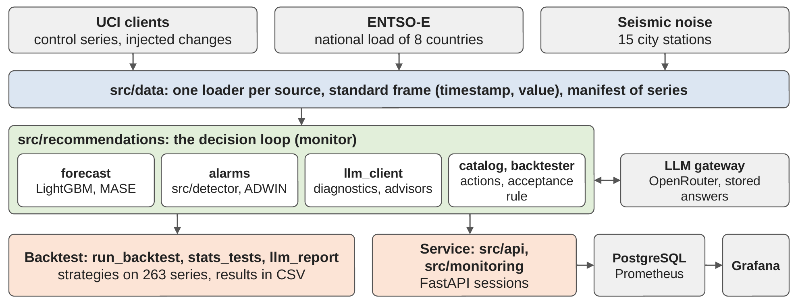
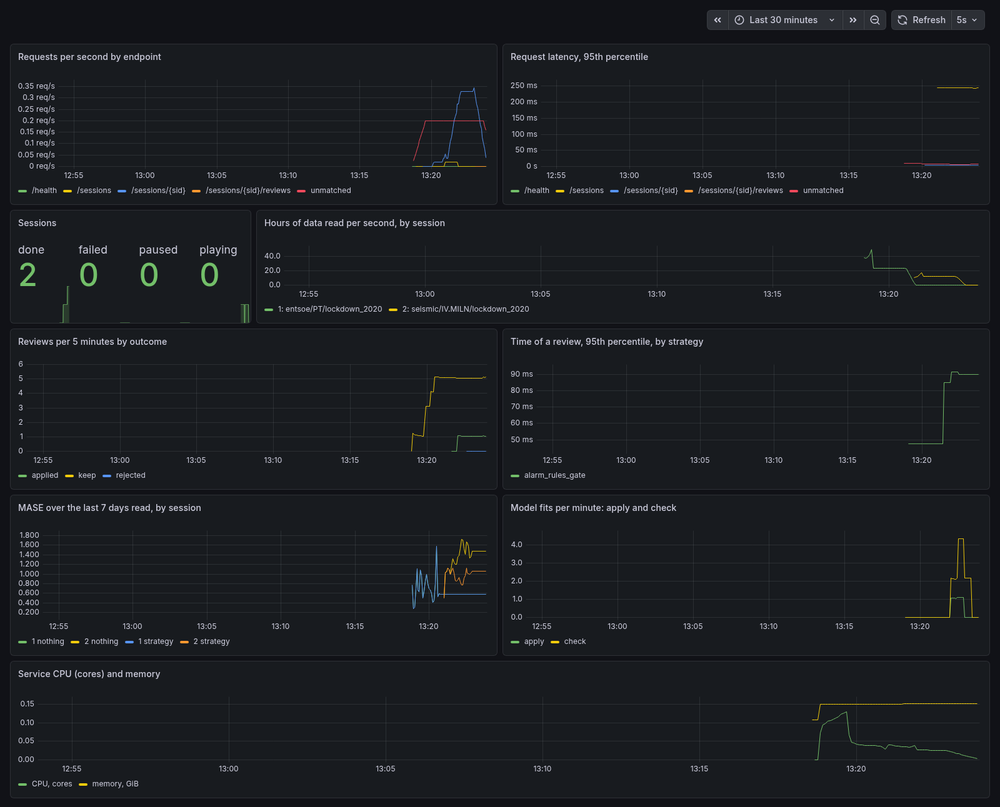

## Repository Structure

```text
    seasonality-drift-llm-mlops/
    │
    ├── data/                       # Directory for datasets
    │   ├── raw/                    # Raw data (Alibaba, UCI Electricity, TCPDBench, SeisBench)
    │   ├── processed/              # Processed and synthetically labeled series; stream_b/ holds the results of stream B
    │   ├── llm_answers.zip         # Stored answers of the LLM advisors (unpack to rerun without an API key)
    │   └── demo/                   # The series of the demo notebook and the stored LLM answers on it
    │
    ├── notebooks/                  # Research Jupyter Notebooks for experiments
    │   ├── 01_eda_and_baselines.ipynb
    │   ├── 02_residual_conformal_evaluation.ipynb # Stream A: Residual conformal evaluation & visualization
    │   └── 02_stream_b_baselines.ipynb  # Stream B: strategies, oracles, examples
    │
    ├── src/                        # Core service source code
    │   ├── __init__.py
    │   ├── data/                   # Shared by both streams: loaders, the standard frame, the manifest
    │   │   ├── uci.py, entsoe.py, seismic_noise.py, alibaba.py, tcpd.py, iquique.py   # one loader per source
    │   │   ├── frames.py           # standard frame (timestamp, value), series_table, write_series
    │   │   ├── loader.py           # DataLoader class interface used by stream A
    │   │   └── export.py           # python -m src.data.export: the stream B series as CSV + manifest.csv
    │   ├── detector/               # Stream A: Drift detectors and decomposition
    │   │   ├── data_loader.py          # Kept import path of DataLoader (the loaders live in src/data)
    │   │   ├── drift_generator.py      # STL decomposition + 3-level benchmark generation
    │   │   ├── baseline_detectors.py   # KS, PSI, ADWIN, Page-Hinkley, KSWIN (River / SciPy)
    │   │   ├── residual_detector.py    # STL decomposition + adaptive conformal intervals on residuals
    │   │   ├── generate_benchmarks.py
    │   │   ├── run_baseline_evaluation.py # Baseline metric runner 
    │   │   └── run_residual_detector_evaluation.py # Residual conformal evaluation runner
    │   │
    │   ├── recommendations/        # Stream B: LLM diagnostics and backtesting
    │   │   ├── forecast.py         # LightGBM day-ahead model, seasonal naive, MASE
    │   │   ├── catalog.py          # Remediation action catalog
    │   │   ├── backtester.py       # Strategies, hindsight oracles, block bootstrap CI of the MASE gain
    │   │   ├── synthetic.py        # Synthetic series from UCI clients (MSTL control series + injected changes)
    │   │   ├── data_sources.py     # ENTSO-E and seismic noise series with features and labels (loaders in src/data)
    │   │   ├── plots.py            # Figures for the stream B notebook
    │   │   ├── run_backtest.py     # Stream B runner
    │   │   ├── stats_tests.py      # Rank tests over the series (Friedman, Nemenyi, Wilcoxon with Holm)
    │   │   ├── strata.py           # Groups of series by seasonal strength
    │   │   ├── llm_report.py       # LLM advisors on the real series: paired tests, action shares, figure
    │   │   ├── prompt_probe.py     # Probe of the prompt wording
    │   │   ├── llm_client.py       # Instructor + Pydantic v2 schemas for LLM
    │   │   ├── alarms.py           # detector alarms: stream A detector and ADWIN (batch and online), alerts file
    │   │   ├── monitor.py          # Monitor: the decision loop as the data arrive (engine of the service)
    │   │   └── demo.py             # Demo on one series: the series, figures, start of a session
    │   │
    │   ├── api/                    # MLOps microservice
    │   │   ├── __init__.py
    │   │   ├── main.py             # FastAPI application (sessions, /detect, /recommendations, /metrics)
    │   │   ├── sessions.py         # sessions playing a series in the background
    │   │   ├── store.py            # history of the sessions in PostgreSQL (for Grafana)
    │   │   ├── uploads.py          # upload of your own series
    │   │   └── schemas.py          # Pydantic schemas for API requests/responses
    │   │
    │   └── monitoring/             # Infrastructure integration
    │       ├── __init__.py
    │       └── metrics.py          # Prometheus metrics (prometheus_client)
    │
    ├── tests/                      # Automated tests (Pytest)
    │   └── test_*.py               # data, alarms, backtester, LLM client, monitor, API, demo, statistical tests
    │
    ├── docs/images/                # Figures of the README
    ├── deploy/                     # Prometheus configuration, Grafana data sources and dashboards
    ├── docker-compose.yml          # Local deployment (FastAPI, PostgreSQL, Prometheus, Grafana)
    ├── Dockerfile                  # FastAPI service containerization
    ├── requirements-service.txt    # Dependencies of the service image
    ├── requirements.txt            # Python 3.11+ dependencies
    ├── LICENSE                     # MIT License
    └── README.md                   # Project description and setup instructions
```


## Architecture



The loaders of `src/data` turn every source into the standard frame (`timestamp`, `value`). The decision loop of
`src/recommendations` is the same code in both uses: the backtest replays it over the 263 series of the experiments
and writes the results to CSV, and the monitoring service plays one series hour by hour and shows the same decisions
in Grafana. The LLM advisor is reached through a gateway (OpenRouter); every answer is stored, so a rerun reads the
stored answers.


## Demo on One Series

`notebooks/demo_one_series.ipynb` takes one hourly series with a visible change through the whole system, one call at
a time: the deployed forecasting model and its error, the detector of stream A, the diagnostics and the prompt of the
advisor, the answer of the LLM, the backtest check, and the error with the system against the model left as deployed.
It needs no data download and no API key:

- the series is `data/demo/demo_seasonal_shift.csv`: a synthetic control series of the experiments whose weekly swing
  becomes 2.5 times larger on 2 December 2013 (`python -m src.recommendations.demo series` writes it again from the
  exported series);
- the answers of the LLM advisor on this series are stored in `data/demo/llm_answers` and are read instead of asking
  the model (with a key and another series the same code asks the model).

On this series the detector raises its first alarm 23 hours after the change. The backtest check stops the first
proposal of the advisor, because one day of new data cannot confirm a gain; the proposal after the next alarm, three
weeks later, passes it, and the error after the change is 1.89 against 3.44 for the model left as deployed (MASE),
45% lower. The strategy is `alarm_llm_gate`, one of the strategies of the experiments.

The same series in the monitoring service with Grafana:

```bash
docker compose up --build -d                   # API, PostgreSQL, Prometheus, Grafana; works without the exported series
python -m src.recommendations.demo session     # uploads the CSV, starts a session, prints the link to the dashboard
```

The last cell of the notebook does the same. The session uses the strategy `alarm_llm_gate`; the image of the service
has no LLM client, so it takes the stored answers (`data/demo/llm_answers` is mounted into the container) and gives
the numbers of the notebook. Any other hourly series can be uploaded in the same way (see "Your own series" below).


## Data Source & Setup

### 1. UCI ElectricityLoadDiagrams 2011–2014 (`LD2011_2014.txt`)

A classic benchmark time-series dataset containing electricity consumption data for 370 clients sampled at 15-minute intervals.

* **Official Source:** [UCI Machine Learning Repository - ElectricityLoadDiagrams20112014](https://archive.ics.uci.edu/dataset/321/electricityloaddiagrams20112014)
* **Direct Download:** [UCI Zip Archive (249 MB)](https://archive.ics.uci.edu/static/public/321/electricityloaddiagrams20112014.zip)

#### Setup Instructions:
1. Download and extract `electricityloaddiagrams20112014.zip`.
2. Move the unzipped `LD2011_2014.txt` file into your local project directory:
   ```path
   data/raw/LD2011_2014.txt
   ```
3. The `load_uci_electricity()` method in `DataLoader` will automatically read and standardize this file.


### 2. Alibaba Cluster Trace 2018 (`alibaba_cluster_trace.csv`)

The raw Alibaba trace is large and resource-intensive to parse from scratch. For faster setup, use the pre-aggregated and cleaned open-access slice provided on Zenodo.

* **Dataset Repository:** [DataCenter-Traces-Datasets on Zenodo](https://zenodo.org/records/14564935)
* **Target File:** `machine_usage_days_1_to_8_grouped_300_seconds.csv` (~200 KB)

#### Setup Instructions:
1. Navigate to the Zenodo dataset page linked above.
2. Download `machine_usage_days_1_to_8_grouped_300_seconds.csv`.
3. Save and rename the file into your local project directory:
```path
   data/raw/alibaba_cluster_trace.csv
   ```
4. The `load_alibaba_standard_trace()` method in `DataLoader` will automatically parse this aggregated CPU/memory usage trace.

### 3. TCPDBench Dataset (`jfk_passengers` / Level 3 Benchmark)

TCPDBench (Time Series Change Point Benchmarks) contains real-world time series datasets with various change points and conceptual drift, which serve as the Level 3 benchmark for validating drift detectors.

- **Official Repository:** [GitHub - TCPDBench/TCPDBench](https://github.com/TimeSeriesAI/TCPDBench)
- **Target File:** E.g., `jfk_passengers.csv` or specific series files from the benchmark repository.

#### Setup Instructions:
1. Download the required time series files from the TCPDBench repository.
2. Place them into your project's raw data directory:
   ```path
   data/raw/tcpd/
   ```
3. The loading method in `DataLoader` will automatically read and prepare the Level 3 series for detector evaluation.

### 4. SeisBench Iquique Seismic Trace Dataset

SeisBench provides standardized seismic datasets for machine learning applications in seismology. The Iquique seismic trace dataset (focusing on P-wave arrivals with ground-truth change points) is used to evaluate drift and abrupt change detection under high-noise geophysical signal conditions.

- **Official Source / Toolkit:** [GitHub - SeisBench/seisbench](https://github.com/seisbench/seisbench)
- **Dataset Focus:** Iquique regional seismic network, P-wave picks, and event-based change points.

#### Setup Instructions:
1. The corresponding loading method in `DataLoader` will automatically ingest the seismic waveform slice, parse the ground-truth change points and prepare it for seasonal-trend drift evaluation.

### 5. ENTSO-E National Load (Open Power System Data), Stream B

Hourly national electricity load of 32 European countries, 2015 to September 2020, from the ENTSO-E Transparency
Platform as packaged by Open Power System Data. Stream B uses 8 countries (IT, PL, ES, NL, PT, FR, DE, GB) and the
date of the first national COVID-19 measures in March 2020 as the moment of change.

- **Official Source:** [Open Power System Data - Time series](https://data.open-power-system-data.org/time_series/2020-10-06)
- **Target File:** `time_series_60min_singleindex.csv` (124 MB)

#### Setup Instructions:
```bash
mkdir -p data/raw/opsd
curl -L -o data/raw/opsd/time_series_60min_singleindex.csv \
  https://data.open-power-system-data.org/time_series/2020-10-06/time_series_60min_singleindex.csv
```

### 6. Seismic Noise During the 2020 Lockdowns (Lecocq et al., 2020), Stream B

Displacement RMS every 15 minutes at seismic stations, November 2019 to May 2020, from the companion repository of
Lecocq et al. (2020), Science 369(6509):1338-1343. The 4-14 Hz band is dominated by human activity (traffic, industry),
so it has clear daily and weekly cycles. Stream B uses 15 stations; the moment of change is the date of the first
measures at each station from the paper's Table S1. This is a different dataset from the SeisBench Iquique records above.

- **Official Source:** [GitHub - ThomasLecocq/2020_Science_GlobalQuieting](https://github.com/ThomasLecocq/2020_Science_GlobalQuieting)

#### Setup Instructions:
```bash
R=https://raw.githubusercontent.com/ThomasLecocq/2020_Science_GlobalQuieting/master
mkdir -p data/raw/seismic_noise
curl -L -o data/raw/seismic_noise/lockdown_stations.csv "$R/Supplementary%20Files/Table%20S1%20-%20Lockdown%20stations.csv"
for f in BE.UCC..HHZ IV.MILN..HHZ IV.FIR..HHZ FR.CURIE.00.HHZ GB.EDI..HHZ NL.ALK1..HGZ GE.STU..HHZ GR.BUG..HHZ \
         CA.ICJA..HHZ CH.SZUZ..HGZ OE.VIE..HHZ LD.CPNY..BHZ AM.R091F.00.EHZ AM.R9F13.00.EHZ AM.S0C34.00.EHZ; do
  curl -L -o "data/raw/seismic_noise/$f.csv" "$R/PaperZero_RMS/$f.csv"
done
```


## Shared data loading (`src/data`)

Both streams read their data through `src/data`. Every loader returns the same standard frame: a DataFrame
with the columns `timestamp` (start of the interval) and `value` (float64), one row per point in time order.
`DataLoader` (`src/data/loader.py`, also importable from `src/detector/data_loader.py`) keeps the class
interface of the stream A scripts and notebooks; `load_uci_electricity` now reads the cleaned hourly client
table of `src/data/uci.py` (timestamps moved to the interval start, DST hours fixed, cached in
`data/processed/uci_hourly.parquet`).

The series of stream B (synthetic UCI, ENTSO-E, seismic noise) can be written as standard frames for the
detectors of stream A:

```bash
python -m src.data.export            # data/processed/series/: one CSV per series + manifest.csv
```

`manifest.csv` has one row per series: `id` (`source/series/scenario`), `file`, the labels (`source`,
`series`, `scenario`, `client`, `seed`, `magnitude`), the length `n`, `start`, and the deployment and
change points both as positions (`t_deploy`, `t_change`, `t_stop`) and as timestamps (`deploy_at`,
`change_at`). Detector alarms on these series are matched to the backtest by `id` and `timestamp`.

## Stream A: Residual Conformal Drift Detection and Evaluation (`src/detector`)

To solve the alert fatigue problem common in seasonal time series (where traditional batch tests like PSI and Wasserstein trigger massive false alarms due to natural seasonality), Stream A implements a **seasonality-aware dual-layer detector**:

- **`residual_detector.py`**: Performs STL decomposition to separate trend, seasonality, and residuals. It computes **adaptive conformal intervals** on the residuals to monitor two independent anomaly dimensions:
  1. *Absolute residual deviation* (detecting sudden level shifts or mean changes).
  2. *Local Interquartile Range (IQR) dispersion* (detecting volatility and amplitude shifts).
- **`run_residual_detector_evaluation.py`**: Executes the evaluation runner across the 3-level benchmark suite (Level 1 clean block-bootstrap series for False Alarm Rate, Level 2 semi-synthetic injected drifts across $0.5\sigma$ to $3\sigma$ magnitudes, and Level 3 real-world consensus datasets).
- **`notebooks/02_residual_conformal_evaluation.ipynb`**: Interactive research notebook containing comparative visualizations, precision-recall breakdowns, and detection delay curves against traditional streaming and batch baselines (ADWIN, KS, PSI, Page-Hinkley, KSWIN, Wasserstein).


## Stream B: Adaptation Strategies and Backtest (`src/recommendations`)

A deployed LightGBM model forecasts every day the next 24 hours (all features use values at least 24 hours old:
hour, weekday, lags 24/48/168/336, lagged daily and weekly means; yearly terms for the national load). A strategy
decides when the model is changed and how:

- `nothing`: the model trained at deployment is never changed;
- `always`: retrain on all history every day;
- `scheduled`: retrain on all history once a week;
- `scheduled_gate`: once a week, retrain on all history only if the acceptance rule confirms the gain;
- `catalog_gate`: once a week, check every catalog action with the acceptance rule and apply the one with the highest
  lower bound of the gain (or keep the model if none passes);
- `oracle_weekly`: once a week, apply the catalog action with the lowest error on the following week, chosen in
  hindsight (the reference for LLM recommendations);
- `oracle`: the same every day with a one-day lookahead (the ideal ceiling).

The oracles use future data, so they cannot be deployed; they only bound what any policy can reach. Action catalog
(`catalog.py`): do nothing, retrain on all history, retrain on the last 8 weeks, shorten the window to 2 weeks,
reweight recent data (half-life 1 week), add a seasonal feature (4-week hour-of-week profile), recalibrate the forecast
level on the last week.

Metrics: MASE (scaled by the weekly seasonal naive error on the training data) before and after the change, regret
against the ideal oracle, number of retrainings, and the gain over `nothing` with a 95% moving block bootstrap
interval over days (blocks of 7 days, 2000 resamples).

Acceptance rule (`check_action` in `backtester.py`): at a decision point the recommended action is replayed on the
last 2 weeks with a weekly rolling origin (its recipe is applied to the data before each origin and forecasts the
following week) and compared with what the deployed model actually forecast there. The action is applied only if the
lower bound of the 95% block bootstrap interval of the gain (blocks of 3 days) is above delta = 0. Only data before
the decision point is used.

LLM recommendations (`llm_client.py`): at a decision point the advisor gets diagnostics computed from the data before
it (weekly errors of the deployed model, bias, level, daily amplitude and noise changes, weeks since the last change)
and answers with one catalog action and a short reason (Pydantic schema, validated by Instructor in JSON mode).
Strategies `llm` (applied as proposed) and `llm_gate` (applied only if the acceptance rule confirms it); `rules` and
`rules_gate` use fixed rules on the same diagnostics. Five prompt variants (`--prompt`): `base` (the system prompt
with the catalog and the diagnostics), `instructions` (plus how to read the diagnostics and when each action fits),
`examples` (plus four worked decisions from a synthetic series that is not evaluated), `bare` (ablation: no
diagnostics) and `rich` (the diagnostics of `base` plus the error and bias of each of the last 14 days, the last 48
hours of values against the forecast, and the previous decision with the error before and after it). Every LLM
answer is stored locally in `data/llm_answers/`. The answers of the reported runs (about 43,000) and of the prompt
probe are kept in git as `data/llm_answers.zip`: `unzip data/llm_answers.zip` in the root of the repository puts
them in place, and a rerun then reads the stored answers and needs no API key. The model string names the provider
first (`openrouter/...`, `anthropic/...`, `ollama/...`);
the key is read from `~/.config/diploma/<provider>.env`, one line `<PROVIDER>_API_KEY=...` (another folder can be
set in `LLM_KEY_DIR`).

Decisions on detector alarms (`alarms.py`, the link with stream A): the strategies `alarm_retrain`, `alarm_gate`,
`alarm_catalog_gate`, `alarm_oracle`, `alarm_rules`, `alarm_rules_gate`, `alarm_llm` and `alarm_llm_gate` take the
same decisions as their weekly counterparts, but at the first origin after an alarm of a drift detector, then ignore
alarms for 7 days (`cooldown_days`). They run once per detector in an alerts file: one row per alarm with `id`
(`source/series/scenario` as in the manifest of `src/data`), `method` and `timestamp` (or `index`); detector
alarms are matched to the series by `id` and `timestamp`. Every row of `runs.csv` also reports `alarms` (alarms after
deployment), `acts_pre` (model changes before the change of the series, all of them on a series without one: the cost
of false alarms or of a fixed calendar) and `reaction_h` (hours from the change to the first model change after it).
The detector of stream A runs on these series as `residual_conformal`: `ResidualConformalDriftDetector` of
`src/detector` with the settings of its multi-series mode for a daily period. Its residual of an hour comes from an STL
fit on a block that ends up to 23 hours later, so an alarm is dated at the end of its block, the first hour at which it
is known (the tests check that the alarms are those of its `fit_predict` and do not depend on later values). ADWIN
(`adwin`) runs next to it as the reference detector, on the residual of each hour from the median of the same hour of
the last 4 weeks, which uses only the past. A conformal stand-in on the same residuals (`profile_conformal`) served
until the stream A detector was connected and has been removed. The sensitivity of every detector
is calibrated per source on a control period without changes (the 60 synthetic control series; the seismic weeks
between deployment and the first measures; the year 2019 of the national load) to one false alarm per 14 days (2.98 per
1000 hours): settings calibrated on one source do not carry over to another. `data/alerts/detectors.csv` records the
chosen settings and the false alarm rate reached: `residual_conformal` gets the multiplier 8 on the national load (1.99
per 1000 hours) and on the seismic noise (3.04, the strictest value of its grid, just above the target) and 4 on the
synthetic series (2.90); ADWIN does not reach the target on the national load even at its strictest setting (8.30).
`data/alerts/alerts.csv` holds the alarms of both detectors (kept in git).

Data: 240 synthetic series (20 UCI clients x 3 seeds x {no change, level shift 2 sigma, one-week ramp 2 sigma,
noise x2}, 24 weeks, deployment at week 10, change at week 13), the national load of 8 countries (dataset 5,
deployment 6 January 2020) and the seismic noise level at 15 stations (dataset 6, hourly log10 on the local clock,
deployment 3 February 2020).

#### Run:
```bash
export OMP_NUM_THREADS=1                                     # every process trains its own models
python -m src.recommendations.run_backtest --tune            # base model validation (not the test period)
python -m src.recommendations.run_backtest                   # all sources, about 40 minutes on 16 cores
python -m src.recommendations.run_backtest --sources seismic # recompute one source, keep the other rows
python -m src.recommendations.run_backtest --advisors rules  # add the advised strategies (rules, llm) to runs.csv
python -m src.recommendations.run_backtest --advisors llm --llm-model ollama/qwen2.5:7b-instruct --prompt examples --repeats 3
                                                             # LLM strategies with one model and one prompt variant
python -m src.recommendations.alarms                         # calibrate the detectors, write data/alerts/alerts.csv
python -m src.recommendations.run_backtest --alerts data/alerts/alerts.csv --advisors rules
                                                             # add the strategies that review on alarms, per detector
python -m src.recommendations.llm_report                     # LLM advisors on the real series: paired tests against the
                                                             # reference strategies, shares of the chosen actions and the
                                                             # figure of error against retrainings (docs/images)
python -m src.recommendations.prompt_probe                   # probe of the prompt wording: the same diagnostics with a system
                                                             # message that states the goal and the costs (data/llm_probe)
python -m pytest tests                                       # tests
```

Results are written to `data/processed/stream_b/` (`runs.csv`, `summary.csv`, `oracle_picks.csv`, `tune.csv`,
`example_*.csv`); tables and figures are in `notebooks/02_stream_b_baselines.ipynb`. The published results were
computed with Python 3.12, numpy 2.2.6, pandas 2.3.3, statsmodels 0.15.0 and lightgbm 4.7.0.

#### Stored results

The results of the reported runs are kept in git in `data/processed/stream_b/`, so the notebooks of stream B and
`stats_tests.py` work on a clean clone without a rerun: `runs.csv` (one row per series, strategy and repeat),
`summary.csv`, `strata.csv`, `oracle_picks.csv`, `tune.csv`, `recalibrate_weekly.csv`, the tables of `llm_report.py`
(`llm_paired_tests.csv`, `llm_synthetic_tests.csv`, `llm_action_shares.csv`) and the three series of the examples
(`example_*.csv`).

#### Statistical comparison of the strategies

`src/recommendations/stats_tests.py` compares the strategies over the series with the rank tests recommended by
Demsar (2006): per series the strategies are ranked by MASE after the change (on the control series by MASE after
deployment), the Friedman test and its Iman-Davenport form check whether the average ranks differ, the Nemenyi critical
difference shows which differences of average rank are significant, and paired Wilcoxon signed-rank tests with the
Holm correction check the comparisons behind the claims (the checked schedule against the plain one, the rules with
and without the check and against doing nothing, retraining on alarm against the calendar, the best checked action
against the weekly oracle). The groups are the national load, the seismic noise, both together, and each synthetic
scenario; the ranking contains the 17 deployable strategies, the oracles and the seasonal naive forecast are
references. `notebooks/05_stream_b_statistical_tests.ipynb` reads `runs.csv` and shows the tables and the critical
difference diagrams.

## Monitoring Service (`src/api`, `src/monitoring`, Docker)

The service runs the decision loop of stream B on a deployed model as the data arrive. A **session** plays one
exported series hour by hour from the deployment of the model: every day at 00:00 the model forecasts the next 24
hours, each new value is compared with its forecast and fed to a drift detector, and on an alarm (or on the calendar,
for the weekly strategies) the strategy reviews the model: the advisor proposes a catalog action, the acceptance rule
replays it on the last two weeks, and the action is applied only if the lower bound of the 95% interval of the gain is
above 0. A second run of `nothing` on the same series shows the error the model would have without any change.

The decisions are taken by the code of the backtest (`StrategyRun` in `backtester.py`, the loop that `backtest` also
drives), and the detectors run one value at a time (`OnlineDetector` in `alarms.py`) with the alarms of the
batch functions. A series played to its end therefore gives the numbers of `runs.csv`: for example, the national load
of Portugal under `alarm_rules_gate` with `residual_conformal` ends with 4 alarms, 4 reviews, no model change and MASE
after the change 0.7548643518593062, the value in `runs.csv`. `tests/test_monitor.py` and `tests/test_api.py` check
this on a small series.

- `src/recommendations/monitor.py`: `Monitor`, the engine of a session (no web code).
- `src/api/main.py`: FastAPI application; `sessions.py` (sessions playing in the background), `uploads.py` (series
  added through the API), `store.py` (history in PostgreSQL for Grafana), `schemas.py` (requests and answers).
- `src/monitoring/metrics.py`: Prometheus metrics, served at `/metrics/`.
- `docker-compose.yml`, `Dockerfile`, `requirements-service.txt`: the API, PostgreSQL, Prometheus and Grafana;
  `deploy/` holds the Prometheus configuration and the provisioned Grafana data sources and dashboards.

#### Run:
```bash
python -m src.data.export                 # once: the series the service plays, in data/processed/series
docker compose up --build -d              # API http://localhost:8000/docs, Grafana http://localhost:3000, Prometheus :9090
curl -X POST localhost:8000/sessions -H 'content-type: application/json' \
     -d '{"series_id": "seismic/IV.MILN/lockdown_2020", "strategy": "alarm_rules_gate", "detector": "residual_conformal", "speed": 12}'
                                          # the answer has `grafana_url`: the dashboard of this session around the change
curl -X POST 'localhost:8000/series/csv?name=shop_42&deploy_at=2024-03-04' -H 'content-type: text/csv' \
     --data-binary @my_series.csv         # your own data: see "Your own series" below
docker compose down                       # stop (add -v to delete the history and the uploaded series)
uvicorn src.api.main:app --port 8000      # or without Docker: no history for Grafana, the API and the metrics stay
```

#### Your own series

The loop also runs on data that are not part of the experiments. A series is uploaded as a standard frame, a CSV with
the columns `timestamp` and `value` and one row per hour without gaps (`POST /series/csv`, the file is the body of the
request), or as JSON with `start` and `values` (`POST /series`). `deploy_at` is the moment the forecasting model goes
to work: the values before it are its history (at least 8 weeks), the values from it on are played by a session (at
least 3 weeks); `change_at` is optional and only adds the error after a known change to the answers. The series gets
the id `user/<name>/uploaded` and is then used like an exported one in `POST /sessions` and `POST /detect`; it is kept
in `data/processed/uploads` (a Docker volume) and can be deleted with `DELETE /series/{id}`.

The detector settings of the experiments are calibrated per source, so an uploaded series gets its own: each detector
is calibrated on the history of the series, on the hours from week 5 to the deployment, to the same target of one false
alarm per 14 days, and the answer of the upload shows the settings and the rate reached. Only values before the
deployment are used. One series gives a short control period (3 weeks at the minimum history), so these settings are
rougher than those of the experiments and tend to be more sensitive; `detector_value` of a session overrides them.
For example, the Milan series uploaded as a CSV gets the multiplier 5 for `residual_conformal` from its own 8 control
weeks (8 in the experiments, from 15 stations) and ends with 3 alarms, 2 model changes and MASE after the change
1.120; with `detector_value` 8 it gives the session of the exported series, 1 alarm and 1.142. The features use the
hour and the weekday of the timestamps as they are given, so the stamps should follow the clock of the daily cycle.

Endpoints: `GET /series`, `POST /series`, `POST /series/csv`, `DELETE /series/{id}` (uploaded series),
`GET /strategies` (strategies, detectors, calibrated settings, catalog), `POST /sessions`
(series, strategy, detector, `speed` in hours of data per second, `skip_to_days_before_change`, `paused`),
`GET /sessions`, `GET|PATCH|DELETE /sessions/{id}` (state, errors, counters; speed and pause),
`POST /sessions/{id}/advance` (read hours at once), `GET /sessions/{id}/reviews` (every review: trigger, proposal and
reason of the advisor, checks with gain and interval, action, time taken), `POST /recommendations` (what the advisor
proposes now and whether the check confirms it, without applying it), `POST /detect` (alarms of a detector on
an exported series or on posted values), `GET /health`, `GET /metrics/`.

Grafana (anonymous view, admin/admin to edit): **Drift monitor** shows a session on the clock of the series: the values
and both forecasts, the error over the last 7 days, the alarms and reviews as marks, and the table of reviews with the
gain and its interval. **Drift service** shows the live service metrics: requests and latency, sessions, hours read
per second, reviews by outcome, time of a review, model fits for actions and for checks, CPU and memory.




Prometheus metrics (labels `session`, `series`, `strategy`, `detector`): `drift_hours_read_total`, `drift_value`,
`drift_forecast{model}`, `drift_mase_7d{model}`, `drift_series_time_seconds`, `drift_alarms_total`,
`drift_reviews_total{trigger}`, `drift_review_outcomes_total{outcome}`, `drift_model_fits_total{purpose}`,
`drift_model_changes`, `drift_last_check_lower_bound`, `drift_review_seconds`, `drift_sessions{state}`,
`drift_api_requests_total`, `drift_api_request_seconds`.

Not yet in the service: the LLM advisor inside the Docker image (the image has no Instructor client; outside Docker the
`llm` strategies work with `llm_model`) and the model registry in MLflow. The detector of stream A runs in the service
as `residual_conformal` (`ResidualStream` in `alarms.py` feeds it one value at a time; an alarm arrives at the end of
its STL block, up to 23 hours after the hour that raised it).


## License

The code of this repository is released under the MIT License (see `LICENSE`). The datasets are not part of the
repository and keep the licences of their sources, listed in "Data Source & Setup"; the series of the demo in
`data/demo` is derived from the UCI ElectricityLoadDiagrams20112014 dataset (CC BY 4.0).
